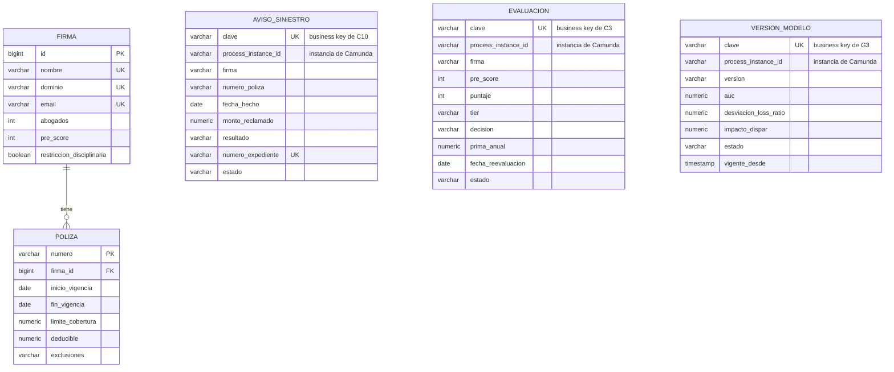

# ARCA · Servicios de negocio y Score Engine

Servicio REST con Spring Boot 3.5.5, Java 21 y PostgreSQL 16. Guarda los datos del negocio de ARCA (firmas, pólizas, avisos de siniestro, evaluaciones y versiones del modelo) y contiene el **Score Engine**. El motor BPM, [arca-bpm-engine](https://github.com/DAMT777/arca-bpm-engine), lo invoca desde las tareas de servicio de C10, C3 y G3 y usa sus respuestas para decidir el camino de cada proceso.

Este repositorio es un componente de [ARCA · hub del proyecto](https://github.com/DAMT777/arca-hub).

## Modelo de datos



Los avisos, evaluaciones y versiones nacen de un proceso. Cada uno guarda la **clave de negocio** (por ejemplo `AV-…`, `EV-…`, `VM-…`) y el **id de su instancia en Camunda**: así se puede ir del dato a la instancia en Cockpit y al revés.

| Tabla | Estados que recorre |
|---|---|
| `aviso_siniestro` | `RECIBIDO` → `PREVERIFICADO` → `EXPEDIENTE_ABIERTO` → `SINIESTRO_REGISTRADO`, o `CERRADO_SIN_COBERTURA` |
| `evaluacion` | `CUESTIONARIO_PRESENTADO` → `PUNTAJE_CALCULADO` → `COTIZADA` o `PLAN_DE_MEJORA` → `ACEPTADA` o `DECLINADA` |
| `version_modelo` | `EN_CALIBRACION` → `EN_VALIDACION` → `SOMETIDA_AL_CARRIER` → `EN_DESPLIEGUE` → `VIGENTE` (la anterior pasa a `REEMPLAZADA`), o `DESPLIEGUE_REVERTIDO` |

### Inicialización reproducible

Al arrancar, Spring ejecuta dos scripts de `src/main/resources/` (`spring.sql.init.mode: always`):
- [`schema.sql`](src/main/resources/schema.sql) crea las tablas, sus restricciones y la secuencia de expedientes, si no existen.
- [`data.sql`](src/main/resources/data.sql) carga los datos de ejemplo con `ON CONFLICT DO NOTHING`, así que no se duplican en cada arranque.

| Firma de ejemplo | Email para ingresar al portal | Pre-Score | Póliza |
|---|---|---|---|
| Smith & Lee LLP | `riesgos@smithlee.com` | 60 | `POL-2026-0042`, vigente del 1-mar-2026 al 1-mar-2027 |
| Garcia Legal Group | `socios@garcialegal.com` | 74 | `POL-2026-0107`, vigente del 1-jun-2026 al 1-jun-2027 |
| Rivera & Cole LLP | `operaciones@riveracole.com` | 48, con restricción disciplinaria | `POL-2025-0310`, vencida el 1-ene-2026 |

También se carga la versión `v2.0.0` del modelo como vigente.

Para empezar de cero se borra el volumen; al volver a arrancar, los scripts recrean todo:

```bash
docker compose down -v
```

## API

| Método y ruta | Uso |
|---|---|
| `POST /api/firmas` · `GET /api/firmas?email=` · `?dominio=` · `?nombre=` | Registro e ingreso de la firma; identificación por dominio |
| `GET /api/firmas/{id}/polizas` | Pólizas de la firma |
| `GET /api/polizas/{numero}/vigencia?fecha=&firma=` | Existencia, titularidad y vigencia a la fecha del hecho, con el motivo |
| `POST /api/avisos` · `PUT /api/avisos/{clave}` · `POST /api/avisos/{clave}/expediente` · `GET /api/avisos` | Avisos de siniestro (C10) |
| `POST /api/evaluaciones` · `PUT /api/evaluaciones/{clave}` · `GET /api/evaluaciones` | Evaluaciones de riesgo (C3) |
| `POST /api/score/pre-score` · `/puntaje` · `/cotizacion` · `/plan-mejora` | Score Engine (C1 y C3) |
| `POST /api/versiones` · `/{clave}/backtesting` · `/{clave}/vigencia` · `PUT /api/versiones/{clave}` · `GET /api/versiones` | Versiones del modelo (G3) |

Las entradas se validan: dominio, email, fechas, número de abogados, puntajes de 0 a 100, decisiones y resultados permitidos. Un dato inválido responde 400; una firma repetida, 409; un registro que no existe, 404. El cuerpo siempre es `{"error": "…"}`.

## Cómo levantarlo

Requisitos: JDK 21 y Docker. Arráncalo **antes** que arca-bpm-engine.

1. Copia `.env.example` como `.env` y cambia `SERVICIOS_DB_PASSWORD`. `.env` no se versiona.
2. Levanta la base de datos (puerto 5434):

   ```bash
   docker compose up -d
   ```

3. Arranca el servicio (puerto 8091; en Windows: `mvnw.cmd spring-boot:run`):

   ```bash
   ./mvnw spring-boot:run
   ```

Para comprobar que responde y que cargó los datos de ejemplo:

```bash
curl http://localhost:8091/api/firmas
```

Para ver los registros que dejan los procesos durante la demostración, desde esta carpeta:

```bash
docker compose exec postgres psql -U arca -d arca_negocio -c "SELECT clave, estado, numero_expediente, process_instance_id FROM aviso_siniestro"
```

| Variable | Por defecto | Uso |
|---|---|---|
| `SERVICIOS_DB_HOST`, `SERVICIOS_DB_PORT`, `SERVICIOS_DB_NAME`, `SERVICIOS_DB_USER` | `localhost`, `5434`, `arca_negocio`, `arca` | Conexión a Postgres |
| `SERVICIOS_DB_PASSWORD` | — | Contraseña de Postgres; obligatoria |
| `SERVICIOS_PORT` | `8091` | Puerto del servicio |

## Pruebas automáticas

```bash
./mvnw test
```

Usan H2 en modo PostgreSQL con los mismos `schema.sql` y `data.sql`. Comprueban:
- la carga de datos de ejemplo;
- la vigencia según la fecha y la firma;
- el expediente único;
- los cálculos del Score Engine guardados en la evaluación;
- el reemplazo de la versión vigente;
- el rechazo de entradas inválidas y duplicadas.

## Responsables

El servicio atiende a los tres procesos. Cada integrante es responsable de la parte de su proceso:

| Parte | Responsable |
|---|---|
| Firmas, pólizas y avisos de siniestro (C10) | Diego Alejandro Machado Tovar |
| Score Engine y evaluaciones (C3) | Jesus Gregorio Delgado |
| Versiones del modelo (G3) | Johan Sebastian Forero Agudelo |
